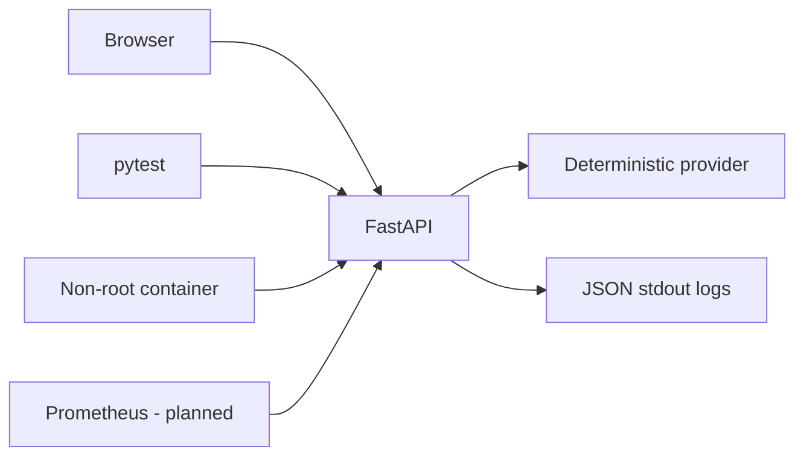

# Weather Status

A small weather workload for learning reliable delivery and operations, built for Ibrahim Shittu's Junior DevOps / Cloud Engineer portfolio.

**Current scope:** tested FastAPI service, single-page interface, deterministic offline provider, structured request logs, Prometheus metrics, non-root Docker image definition, and local Compose configuration. Open-Meteo live weather is implemented; AWS deployment is not implemented yet. The demo timestamp and temperatures are fixed fixtures, not current observations.

## Run locally (PowerShell)

Use Python 3.13 and run from this directory:

```powershell
python -m venv .venv
.venv/Scripts/python.exe -m pip install -r requirements-dev.txt
.venv/Scripts/python.exe -m pytest -q
$env:WEATHER_MODE = "openmeteo"
.venv/Scripts/python.exe -m uvicorn app.main:app --host 127.0.0.1 --port 8000 --no-access-log
```

Open http://127.0.0.1:8000. In another terminal:

```powershell
.venv/Scripts/python.exe scripts/smoke.py
```

On Linux/macOS, use `.venv/bin/python` instead. The lock files pin all resolved packages; install `requirements.txt` for runtime only. The Python implementation requires 3.11 or newer; the container targets 3.13.

## Docker

Start Docker Desktop with Linux containers, then:

```powershell
docker compose up --build -d
python scripts/smoke.py
docker compose logs weather
docker compose down
```

Compose binds only localhost. The container runs as UID 10001, with dropped capabilities and a read-only filesystem. The base image is pinned to the registry digest resolved during the initial build. Update the tag and digest together during dependency maintenance.

## API contract

| Route | Purpose |
|---|---|
| `/` | Accessible city form with loading and error behavior |
| `/api/weather?city=Atlanta` | Demo city, Celsius temperature, conditions, observation timestamp, provider and demo flag |
| `/health` | Process liveness; independent of provider |
| `/ready` | Configuration loaded; independent of provider availability |
| `/version` | Application version, commit and mode |
| `/metrics` | Prometheus request counts, latency and provider failures |

Demo cities: Atlanta, New York, London, Lagos. Springfield demonstrates an ambiguous lookup (409). Unknown cities return 404; invalid input returns 422. Provider adapter errors map to safe 429/503/504 responses. A five-second total deadline bounds provider work. Live mode makes HTTPS calls to Open-Meteo geocoding and forecast endpoints with 2.5-second per-operation timeouts. It does not automatically retry failures.

`WEATHER_MODE` supports `mock` and `openmeteo`. Direct Python startup defaults to mock; Compose defaults to openmeteo. Unsupported values fail startup. `APP_COMMIT` defaults to `local`; set a Git SHA when building a release. There are no secrets in this milestone. Disable Uvicorn access logs as shown to avoid logging query strings; application logs contain generated request IDs, route templates, status, duration and release metadata.

Metrics are available locally on the same port. Any future public ingress must explicitly allow only application routes and exclude `/metrics`; this app is not ready for unrestricted public access.

## Learning path and evidence

See [role alignment](docs/role-alignment.md) for the CirrusLabs requirements and [next session](docs/next-session.md) for the next build steps. Maintain [the evidence log](docs/evidence.md), distinguishing code written from behavior demonstrated.



Implementation references: [FastAPI testing](https://fastapi.tiangolo.com/tutorial/testing/) and [FastAPI containers](https://fastapi.tiangolo.com/deployment/docker/).


## Live weather with Open-Meteo

The UI now suggests cities after two characters and a 350 ms pause. Select a city/state/country entry to load its weather automatically. Suggestions exclude airports and landmarks; the selected GeoNames ID is resolved server-side so same-name cities remain distinct. Editing the text clears the selection and cancels outdated requests. Mock mode offers the four offline cities.

`GET /api/locations?q=Ilorin` returns selectable IDs and labels. `GET /api/weather?location_id=2337639` fetches the selected location; the existing city query remains supported. Location search requests are debounced in the browser but not cached server-side; weather responses retain their five-minute cache.

Docker Compose starts live mode by default. Search **Atlanta, Georgia** or **London, United Kingdom**. Ambiguous names return 409 and ask for a region; no matching place returns 404. No API key is needed. Data is model-based current conditions, not a direct station observation. The UI labels the provider and UTC valid time and includes Open-Meteo/GeoNames attribution.

Successful city results are cached for five minutes, with a maximum of 128 entries per process. Cache entries disappear on restart and are not shared between replicas. Concurrent misses can still make separate provider requests; this is quota reduction, not a global rate limiter. Errors are not cached. Tests use mocked HTTP responses and consume no provider quota.

For offline Docker mode, set `$env:WEATHER_MODE = "mock"` before `docker compose up -d`; remove the override with `Remove-Item Env:WEATHER_MODE` to restore the Compose live default. The default smoke test searches Atlanta, Georgia for live mode.

Provider references: [weather API](https://open-meteo.com/en/docs), [geocoding API](https://open-meteo.com/en/docs/geocoding-api), [usage terms](https://open-meteo.com/en/terms). This integration uses the free noncommercial endpoint. Review usage terms before changing the application's purpose.
